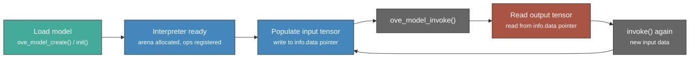
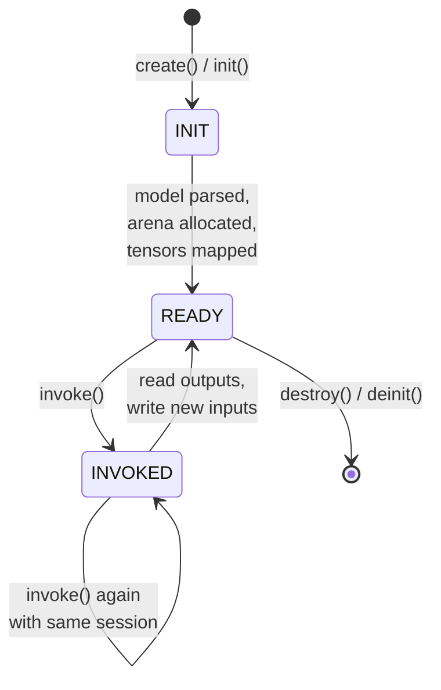
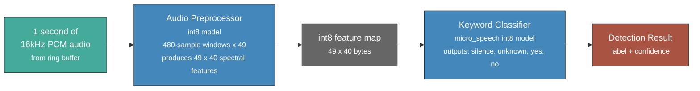

# ML Inference

The oveRTOS inference module provides a portable C API for loading pre-trained `.tflite` FlatBuffer models and running inference via LiteRT (formerly TensorFlow Lite Micro). The same model binary runs unchanged across every oveRTOS backend — FreeRTOS, Zephyr and NuttX. Models are trusted build-time assets. Use `models/convert.py` to generate `const` arrays aligned to 16 bytes; externally integrated arrays need the same alignment and immutable lifetime. TFLM is compiled unmodified at the manifest revision.

## Pipeline



## Tensor Types

| Enum Value | Description |
|------------|-------------|
| `OVE_TENSOR_FLOAT32` | 32-bit IEEE 754 float — full-precision models |
| `OVE_TENSOR_INT8` | Signed 8-bit integer — standard quantised MCU models |
| `OVE_TENSOR_UINT8` | Unsigned 8-bit integer — legacy TFLite quantisation |
| `OVE_TENSOR_INT16` | Signed 16-bit integer — higher-precision quantisation |
| `OVE_TENSOR_INT32` | Signed 32-bit integer — accumulator and index tensors |

## Model Lifecycle



1. **INIT** -- `ove_model_create()` or `ove_model_init()` parses the FlatBuffer, allocates the tensor arena, and registers TFLM operators. Misaligned model bytes return `OVE_ERR_INVALID_PARAM`; a schema mismatch returns `OVE_ERR_NOT_SUPPORTED`. Startup prechecks and detected allocation/planner exhaustion return `OVE_ERR_NO_MEMORY`; other setup failures return `OVE_ERR_ML_FAILED`. Malformed programs and intermediate undersized arena configurations have no safe-failure guarantee.
2. **READY** -- The session is ready. Call `ove_model_input()` to get a pointer into the tensor arena, write input data there, then call `ove_model_invoke()`.
3. **INVOKED** -- Inference has run. Call `ove_model_output()` to read results. The session can be reused — write new inputs and call `invoke()` again without re-creating the model.

## API Reference

| Function | Signature | Description |
|----------|-----------|-------------|
| `ove_model_init` | `(model, storage, arena, cfg) → int` | Initialise using caller-supplied storage and arena; no heap allocation |
| `ove_model_deinit` | `(model) → void` | Release resources; static storage and arena are not freed |
| `ove_model_create` | `(model, cfg) → int` | Allocate and initialise from heap; heap-mode only |
| `ove_model_destroy` | `(model) → void` | Destroy and free a heap-allocated model session |
| `ove_model_invoke` | `(model) → int` | Run inference on the currently populated input tensors |
| `ove_model_input` | `(model, index, info) → int` | Get a descriptor for input tensor at `index`; write to `info->data` before invoking |
| `ove_model_output` | `(model, index, info) → int` | Get a descriptor for output tensor at `index`; read from `info->data` after invoking |
| `ove_model_last_inference_us` | `(model) → uint64_t` | Return the duration of the last `invoke()` in microseconds (requires `CONFIG_OVE_TIME`) |
| `ove_model_arena_used` | `(model) → size_t` | Report interpreter usage plus original arena alignment padding; zero for null or accessible closed handles |

## Model Config Struct

<!-- ove:body -->
```c
struct ove_model_config {
    const void *model_data;  /* pointer to .tflite FlatBuffer (typically in flash) */
    size_t      model_size;  /* size of model_data in bytes                        */
    size_t      arena_size;  /* tensor arena size in bytes — must fit all layers   */
};
```

Measure a generously sized configuration on the actual target and kernel provider
with `ove_model_arena_used()`. Keep the configured arena at least that usage plus
16 bytes and retain the preparation capacity established by qualification. Final
usage can exclude temporary setup peaks; do not shrink until setup fails.
Re-measure after model, provider or TFLM changes. Aligning the arena to 16 bytes
avoids front padding. Model bytes themselves must always be 16-byte aligned.

The arena contract has three regions:

| Capacity | Behavior |
| --- | --- |
| Below the startup precheck minimum | `OVE_ERR_NO_MEMORY`, before SDK construction |
| Persistent/preparation requirements met but activation/planner capacity exhausted | `OVE_ERR_NO_MEMORY` |
| Between that minimum and the model's persistent/preparation requirement | Configuration error with undefined behavior |

Upstream kernels may use failed allocations in the third region. Address zero
can map RAM on a target, so a null-based write need not fault. Each admitted
setup clears the effective arena before constructing SDK objects, costing
O(arena_size). Alignment and schema checks do not validate arbitrary model
programs. See the [runtime contract](../internals/inference-runtime.md) for the
known upstream behavior, qualification policy and revision-update checklist.

## Tensor Info Struct

<!-- ove:body -->
```c
struct ove_tensor_info {
    void                *data;    /* tensor data — output access is read-only */
    size_t               size;   /* total size of tensor data in bytes                        */
    enum ove_tensor_type type;   /* element type (FLOAT32, INT8, etc.)                        */
    unsigned int         ndims;  /* number of dimensions                                      */
    int                  dims[5]; /* shape, e.g. {1, 49, 40, 1} for a spectrogram             */
};
```

Write input data directly to `info->data` before calling `ove_model_invoke()`. Read output data from `info->data` after the call returns. Outputs are read-only and may refer to immutable model constants. The pointer remains valid for the lifetime of the model session.

## Allocation Strategies

**Static (zero-heap) — `init` / `deinit`:**

Supply a caller-allocated storage struct and arena buffer. Both must remain valid for the session lifetime. The arena should be 16-byte aligned for CMSIS-NN.

```c
/* models/<dir>/my_model.tflite, converted by the build into
 * g_my_model_model_data.h, which declares: */
extern const unsigned char g_my_model_model_data[];
extern const unsigned int  g_my_model_model_data_len;

static ove_model_storage_t model_storage;
static uint8_t __attribute__((aligned(16))) arena[32768];

int load_model(ove_model_t *model)
{
    struct ove_model_config cfg = {
        .model_data  = g_my_model_model_data,
        .model_size  = g_my_model_model_data_len,
        .arena_size  = sizeof(arena),
    };
    return ove_model_init(model, &model_storage, arena, &cfg);
}
```

Only one model session can exist at a time: the backend shares one interpreter between sessions. A pipeline with several models (such as the keyword example below) loads them one after the other into the same storage and arena, deinitialising each before loading the next. The C++, Rust and Zig bindings wrap this pattern; see [Binding Semantics](../internals/binding-semantics.md#inference).

The backend enforces one admitted session across handles: init/create returns
`OVE_ERR_BUSY` before storage/output writes, allocation or interpreter setup.
Admission covers constructor failure cleanup, destructors and final frees.
Losing a session without closing it retains admission indefinitely; a new
constructor does not recover it. Raw operations on one live handle must be
externally serialized, and retained model bytes/storage/arena must outlive the
final close call returning. An old handle cannot be reused after its storage
is initialized for another session. This rule does not validate arbitrary
model graphs or make arbitrary arena sizes safe; existing valid-model and
sufficient-arena preconditions remain.


**Heap-mode — `create` / `destroy`:**

`ove_model_create()` is heap-mode only — it allocates storage and arena from the RTOS heap. In zero-heap builds the symbol is unavailable; use `ove_model_init()` with a caller-supplied arena, or `OVE_MODEL_DEFINE_STATIC()` at file scope (which works in both modes).

<!-- ove:fragment -->
```c
ove_model_t model;
if (ove_model_create(&model, &cfg) == OVE_OK) {
    /* ... run inference ... */
    ove_model_destroy(model);
}
```

## Example: Keyword Detection with Audio Preprocessor and Classifier

The `example_keyword_live` application runs a two-stage inference pipeline on live DMIC audio. Stage 1 converts 30ms audio windows into log-mel spectral features; stage 2 classifies the 49-frame spectrogram as silence, unknown, "yes", or "no".



```c
#include "ove/ove.h"
#include "ove/infer.h"
#include <string.h>

/* The two models that ship in models/keyword; their generated headers
 * (g_<name>_model_data.h) declare: */
extern const unsigned char g_audio_preprocessor_int8_model_data[];
extern const unsigned int  g_audio_preprocessor_int8_model_data_len;
extern const unsigned char g_micro_speech_quantized_model_data[];
extern const unsigned int  g_micro_speech_quantized_model_data_len;

#define ARENA_SIZE 32768

/* Static storage reused for both model stages */
static ove_model_storage_t model_storage;
static uint8_t __attribute__((aligned(16))) arena[ARENA_SIZE];

/* Stage 1: raw audio → spectral features (int8) */
static int generate_features(const int16_t *audio, unsigned int len,
                              int8_t *features_out)
{
    struct ove_model_config cfg = {
        .model_data = g_audio_preprocessor_int8_model_data,
        .model_size = g_audio_preprocessor_int8_model_data_len,
        .arena_size = ARENA_SIZE,
    };

    ove_model_t preproc;
    if (ove_model_init(&preproc, &model_storage, arena, &cfg) != OVE_OK)
        return OVE_ERR_ML_FAILED;

    struct ove_tensor_info in_info, out_info;
    if (ove_model_input(preproc, 0, &in_info) != OVE_OK ||
        ove_model_output(preproc, 0, &out_info) != OVE_OK) {
        ove_model_deinit(preproc);
        return OVE_ERR_ML_FAILED;
    }

    /* Run one 30ms window per spectrogram row */
    int rc = OVE_OK;
    for (unsigned int frame = 0; frame < 49 && rc == OVE_OK; frame++) {
        memcpy(in_info.data, audio + frame * 320, 480 * sizeof(int16_t));
        rc = ove_model_invoke(preproc);
        if (rc == OVE_OK)
            memcpy(features_out + frame * 40, out_info.data, 40);
    }

    ove_model_deinit(preproc);
    return rc;
}

/* Stage 2: spectral features → keyword label */
static int classify(const int8_t *features, const char **label_out)
{
    static const char *labels[] = { "silence", "unknown", "yes", "no" };

    struct ove_model_config cfg = {
        .model_data = g_micro_speech_quantized_model_data,
        .model_size = g_micro_speech_quantized_model_data_len,
        .arena_size = ARENA_SIZE,
    };

    ove_model_t classifier;
    if (ove_model_init(&classifier, &model_storage, arena, &cfg) != OVE_OK)
        return OVE_ERR_ML_FAILED;

    struct ove_tensor_info in_info, out_info;
    if (ove_model_input(classifier, 0, &in_info) != OVE_OK ||
        ove_model_output(classifier, 0, &out_info) != OVE_OK) {
        ove_model_deinit(classifier);
        return OVE_ERR_ML_FAILED;
    }

    memcpy(in_info.data, features, 49 * 40);
    if (ove_model_invoke(classifier) != OVE_OK) {
        ove_model_deinit(classifier);
        return OVE_ERR_ML_FAILED;
    }

    /* Find highest-scoring class */
    const int8_t *scores = (const int8_t *)out_info.data;
    int best = 0;
    for (int i = 1; i < 4; i++)
        if (scores[i] > scores[best]) best = i;

    *label_out = labels[best];
    OVE_LOG_INF("Inference time: %llu us",
                (unsigned long long)ove_model_last_inference_us(classifier));

    ove_model_deinit(classifier);
    return OVE_OK;
}
```

## Kconfig Options

| Option | Default | Description |
|--------|---------|-------------|
| `CONFIG_OVE_INFER` | `n` | Enable the ML inference subsystem (requires LiteRT/TFLM) |
| `CONFIG_OVE_INFER_CMSIS_NN` | `n` | Use CMSIS-NN optimised kernels on Arm Cortex-M (requires CMSIS-NN library) |
| `CONFIG_OVE_INFER_ARENA_SIZE` | `65536` | Default tensor arena allocation in bytes; can be overridden per-model via `ove_model_config.arena_size`. |

## Headers

| Header | Contents |
|--------|----------|
| `ove/infer.h` | `ove_tensor_type` enum, `ove_tensor_info` struct, `ove_model_config` struct, all model lifecycle functions |
| `ove/storage.h` | `ove_model_storage_t` opaque type (selected per backend) |
