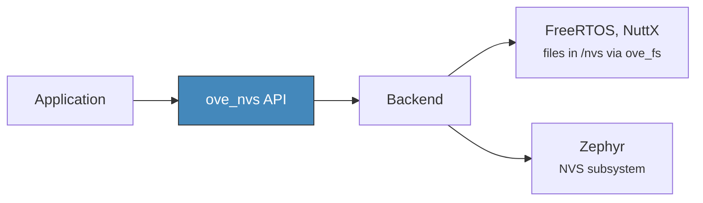

# Non-Volatile Storage

The NVS module provides a key-value store backed by non-volatile storage: files on the mounted volume (FreeRTOS, NuttX) or a flash partition (Zephyr).

## Architecture



## API Reference

| Function | Description |
|----------|-------------|
| `ove_nvs_init()` | Initialize the NVS subsystem (call once at startup) |
| `ove_nvs_deinit()` | Tear down the NVS subsystem |
| `ove_nvs_read(key, buf, buf_len, &out_len)` | Read value by key; `out_len` gets the stored size. Pass `buf=NULL, buf_len=0` to query size only. |
| `ove_nvs_write(key, data, len)` | Write or update a key-value pair |
| `ove_nvs_erase(key)` | Delete a key-value pair; erasing a missing key succeeds |

## Usage

On FreeRTOS and NuttX, NVS lives in `/nvs` on the volume mounted with `ove_fs_mount()` (`CONFIG_OVE_NVS` turns on `CONFIG_OVE_FS` there), so mount first. The QEMU MPS2-AN500 has no storage device and keeps values in RAM until QEMU exits.

```c
/* Initialize (FreeRTOS / NuttX: after ove_fs_mount) */
ove_nvs_init();

/* Write a setting */
uint8_t bypass = 1;
ove_nvs_write("bypass", &bypass, sizeof(bypass));

/* Read it back */
uint8_t val = 0;
size_t out_len = 0;
if (ove_nvs_read("bypass", &val, sizeof(val), &out_len) == OVE_OK) {
    /* val == 1, out_len == 1 */
}

/* Delete */
ove_nvs_erase("bypass");
```

## Error Codes

| Code | Meaning |
|------|---------|
| `OVE_OK` | Success |
| `OVE_ERR_NOT_FOUND` | Key does not exist (returned by `ove_nvs_read`) |
| `OVE_ERR_INVALID_PARAM` | NULL key or invalid arguments |
| `OVE_ERR_NOT_SUPPORTED` | `CONFIG_OVE_NVS` not enabled |

## Kconfig

| Option | Default | Description |
|--------|---------|-------------|
| `CONFIG_OVE_NVS` | `n` | Enable non-volatile key-value storage |

## Header

`ove/nvs.h`
