# Shell & Console

The oveRTOS shell and console subsystems provide an interactive command-line interface over a serial connection. The console layer handles raw byte I/O against the hardware UART; the shell layer sits on top and provides command parsing, dispatch, and built-in help.

## Architecture

```mermaid
graph LR
    UART["Serial RX<br/><small>UART / USB CDC</small>"]
    GETCHAR["ove_console_getchar()<br/><small>input task</small>"]
    PROCESS["ove_shell_process_char()<br/><small>line buffer + backspace</small>"]
    LOOKUP["command lookup<br/><small>registered ove_shell_cmd table</small>"]
    HANDLER["handler(argc, argv)<br/><small>application command function</small>"]
    OUTPUT["ove_console_putchar() / write()<br/><small>Serial TX</small>"]

    UART --> GETCHAR --> PROCESS --> LOOKUP --> HANDLER --> OUTPUT

    style UART fill:#4a9,stroke:#333,color:#fff
    style GETCHAR fill:#48b,stroke:#333,color:#fff
    style PROCESS fill:#48b,stroke:#333,color:#fff
    style LOOKUP fill:#666,stroke:#333,color:#fff
    style HANDLER fill:#a54,stroke:#333,color:#fff
    style OUTPUT fill:#4a9,stroke:#333,color:#fff
```



Characters arrive one at a time from `ove_console_getchar()` in an input task and are fed into `ove_shell_process_char()`. Feed it from thread context, never from an ISR: the matching handler runs inside the call. Every shell call is thread-safe: commands run one at a time under a lock, and `ove_shell_process_line()` keeps its own copy of the line, so the web terminal and a console task can share the shell. A handler may register commands or dispatch a line itself, but must not wait for another thread that is using the shell. Feed characters from one thread, as the line being typed is shared. The shell accumulates them into a line buffer, handling backspace and other editing characters transparently. On newline, the line is split into whitespace-delimited tokens (up to `OVE_SHELL_MAX_ARGS` = 8) and dispatched to the matching registered handler.

## Shell API

| Function | Signature | Description |
|----------|-----------|-------------|
| `ove_shell_init` | `(void) → int` | Initialise the shell and register built-in commands (e.g. `help`). |
| `ove_shell_register_cmd` | `(const struct ove_shell_cmd *cmd) → int` | Copy a command into the dispatch table (16 entries including `help`); the `name` and `help` strings must stay valid while it is registered. Re-registering a name replaces that command, even when the table is full. |
| `ove_shell_process_char` | `(char c) → void` | Feed one raw character into the shell; call from the console input task, never an ISR. |
| `ove_shell_process_line` | `(const char *line) → void` | Process a complete input line (up to 127 characters) through the shell, independently of the line being typed (useful for piping non-UART input like HTTP). |
| `ove_shell_set_output_hook` | `(ove_shell_output_hook_t hook) → void` | Install a hook that also receives each `OVE_LOG_*` line a command handler emits from its own thread while it runs, newline included — the httpd web terminal uses it to send command output to the browser. Pass `NULL` to clear. |

Output-hook prototype:

```c
typedef void (*ove_shell_output_hook_t)(const char *data, size_t len);
```

## Console API

| Function | Signature | Description |
|----------|-----------|-------------|
| `ove_console_init` | `(void) → int` | Configure the serial peripheral (baud rate, framing) as defined by the BSP |
| `ove_console_getchar` | `(void) → int` | Read one character. FreeRTOS returns -1 at once if none is buffered; Zephyr, NuttX and the host test backend wait (Zephyr on the STM32F746 board by busy-polling). Use `ove_console_try_getchar()` to never block. |
| `ove_console_putchar` | `(c) → void` | Transmit one character; may block until the TX buffer has space |
| `ove_console_write` | `(buf, len) → void` | Transmit exactly `len` raw bytes with no newline translation |

## Command Descriptor

Each command is described by an `ove_shell_cmd` structure. Pass a pointer to `ove_shell_register_cmd`, which copies it, so it may live on the stack; the strings its `name` and `help` point to are not copied and must stay valid while the command is registered.

<!-- ove:fragment -->
```c
struct ove_shell_cmd {
    const char       *name;    /* token matched against the first word of input */
    const char       *help;    /* one-line description shown by the built-in help command */
    ove_shell_cmd_fn  handler; /* called when the command is matched */
};

/* Handler prototype */
typedef void (*ove_shell_cmd_fn)(int argc, const char *argv[]);
```

`argc` is always at least 1 (`argv[0]` is the command name). `argv` is `NULL`-terminated. The argument strings are valid only for the duration of the handler call.

## Example: Registering a Custom "status" Command

```c
#include "ove/ove.h"

static void cmd_status(int argc, const char *argv[])
{
    (void)argc;
    (void)argv;
    OVE_LOG_INF("RTOS:  %s", OVE_RTOS_NAME);
    OVE_LOG_INF("Board: %s", ove_board_name());
    OVE_LOG_INF("LEDs:  %u", ove_led_count());
}

static const struct ove_shell_cmd status_cmd = {
    .name    = "status",
    .help    = "Print system status information",
    .handler = cmd_status,
};

void shell_setup(void)
{
    if (ove_console_init() != OVE_OK)
        return;
    if (ove_shell_init() != OVE_OK || ove_shell_register_cmd(&status_cmd) != OVE_OK)
        return;
}

/* Drive the shell from a dedicated task */
static void console_task(void *arg)
{
    (void)arg;
    for (;;) {
        int c = ove_console_getchar();
        if (c >= 0)
            ove_shell_process_char(c);
    }
}
```

Typing `status` at the console will invoke `cmd_status`. Typing `help` prints the name and help string for every registered command.

## Kconfig Options

| Option | Default | Description |
|--------|---------|-------------|
| `CONFIG_OVE_SHELL` | `n` | Enable the interactive shell subsystem |
| `CONFIG_OVE_CONSOLE` | `n` | Enable low-level serial console I/O |

## Headers

| Header | Contents |
|--------|----------|
| `ove/shell.h` | `OVE_SHELL_MAX_ARGS`, `ove_shell_cmd` struct, `ove_shell_cmd_fn` and `ove_shell_output_hook_t` typedefs, shell init/register/process/set_output_hook. |
| `ove/console.h` | Console init, getchar, putchar, write |
