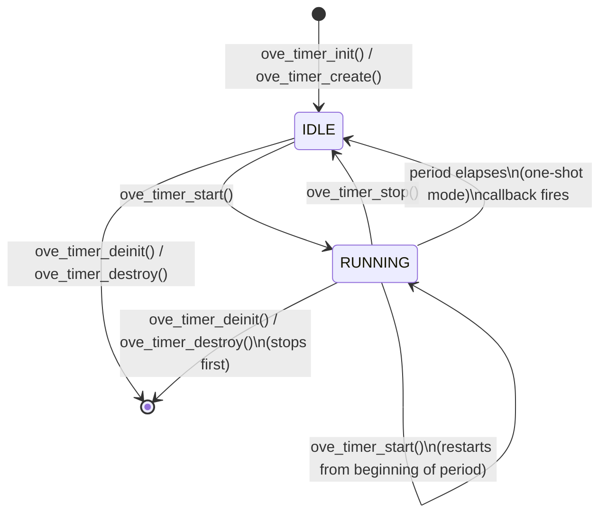
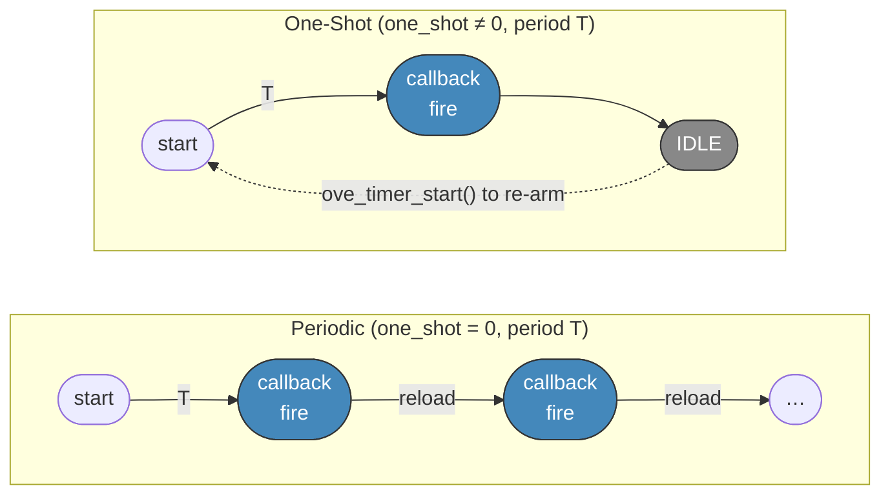
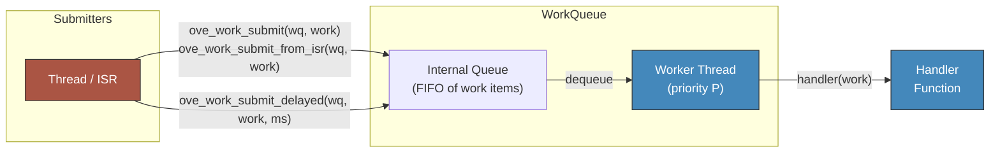
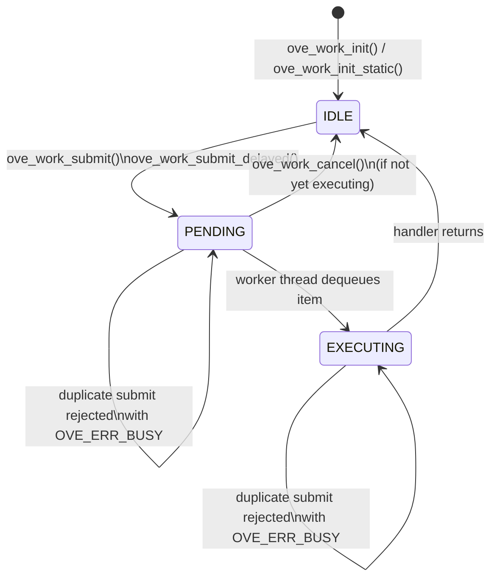

# Timers & Deferred Work

oveRTOS provides two complementary primitives for time-based and deferred execution:

| Primitive | Best for | Execution context |
|-----------|----------|------------------|
| **Timer** | Periodic or one-shot callbacks at a fixed interval | RTOS timer service (backend-specific) |
| **WorkQueue** | Deferring heavier work off a latency-sensitive thread | Dedicated worker thread per queue |

Use a Timer when you need regular time-driven callbacks (polling, statistics, heartbeats). Use a WorkQueue when you need to run heavier work that a latency-sensitive thread should not do itself. `ove_work_submit` is not ISR-safe on FreeRTOS or NuttX: from an interrupt, use `ove_work_submit_from_isr`.

Both follow the standard oveRTOS allocation pattern: `_init` / `_deinit` work in zero-heap mode with caller-supplied storage, while `_create` / `_destroy` are heap-only. The matching `OVE_*_DEFINE_STATIC` macros in `ove/storage.h` combine declaration and init at file scope.

---

## Timer

A software timer calls a user-supplied callback after a specified period. Callbacks run in a backend-specific RTOS context (e.g. the FreeRTOS timer service task) — they must be short and non-blocking. Two modes are supported, selected by the `one_shot` flag at init/create time:

- `one_shot != 0`: fires once then stops automatically.
- `one_shot == 0`: periodic — reloads automatically and fires repeatedly.

Where the callback runs, by backend:

| Backend | Context | Priority |
|---------|---------|----------|
| FreeRTOS | timer service task | `CONFIG_FREERTOS_TIMER_TASK_PRIORITY`, `OVE_PRIO_ABOVE_NORMAL` by default |
| Zephyr | system work queue | cooperative (-1, above every preemptible thread); `OVE_PRIO_NORMAL + 1` with the Linux personality |
| NuttX | high-priority work queue (HPWORK) | native 224, above `OVE_PRIO_REALTIME` |

The host test backend runs callbacks on a dispatcher thread. On Zephyr and NuttX, firings that pile up while a call is still pending may be merged into one. `ove_timer_stop()` may still let one call that is already running or queued run once (on FreeRTOS more, see the API table); `ove_timer_deinit()` and `ove_timer_destroy()` wait for a running call to finish, so never call them from the callback itself.

### State Machine



### Periodic vs One-Shot



The callback receives a handle to the fired timer and the `user_data` pointer supplied at init/create, so a single handler can serve multiple timers:

```c
struct my_ctx {
    uint32_t ticks;
};

static void on_timer(ove_timer_t timer, void *user_data)
{
    struct my_ctx *ctx = user_data;
    ctx->ticks++;
}
```

### API

| Function | Signature | Description |
|----------|-----------|-------------|
| `ove_timer_init` | `int (ove_timer_t *timer, ove_timer_storage_t *storage, ove_timer_fn callback, void *user_data, uint32_t period_ms, int one_shot)` | Initialise a timer from caller-supplied storage in the stopped state. |
| `ove_timer_deinit` | `void (ove_timer_t timer)` | Stop and release the timer. Static storage is not freed. |
| `ove_timer_create` | `int (ove_timer_t *timer, ove_timer_fn callback, void *user_data, uint32_t period_ms, int one_shot)` | Heap-allocate a timer in the stopped state. Requires `OVE_HEAP_TIMER`. |
| `ove_timer_destroy` | `void (ove_timer_t timer)` | Stop and free a heap-allocated timer. |
| `ove_timer_start` | `int (ove_timer_t timer)` | Arm the timer. If already running, restarts from the beginning of the period. |
| `ove_timer_stop` | `int (ove_timer_t timer)` | Stop the timer. A callback already running or queued may still run once; on FreeRTOS, where stop only queues a command for the timer task, more than once if the caller outranks that task, and it returns `OVE_ERR_TIMEOUT` without stopping when the command queue is full. |
| `ove_timer_reset` | `int (ove_timer_t timer)` | Atomically stop+start — useful for watchdog-style "kick" patterns. |
| `ove_timer_get_period_ns` | `uint64_t (ove_timer_t timer)` | The period as last requested (at init or create, or by the last successful `ove_timer_set_period_ns`), not rounded to the engine's tick, and at once even where the engine applies a change later. Kept while stopped; 0 for NULL. Any context. |

Static-storage macro: `OVE_TIMER_DEFINE_STATIC(name, cb, user_data, period_ms, one_shot)` (in `ove/storage.h`).

### Example: 1 Hz Stats Collection

```c
#include <ove/ove.h>

extern struct ove_audio_graph *g_graph;   /* your audio graph */

static ove_timer_t g_stats_timer;

static void stats_cb(ove_timer_t t, void *user_data)
{
    (void)t;
    struct ove_audio_graph_stats stats;
    if (ove_audio_graph_get_stats(g_graph, &stats) != OVE_OK)
        return;
    OVE_LOG_INF("cycles=%llu underruns=%u avg_us=%u",
                (unsigned long long)stats.cycles,
                (unsigned)stats.underruns, (unsigned)stats.avg_process_us);
}

int app_init(void)
{
    int rc = ove_timer_create(&g_stats_timer, stats_cb, NULL,
                              1000 /* ms */, 0 /* periodic */);
    if (rc == OVE_OK)
        rc = ove_timer_start(g_stats_timer);
    return rc;
}

void app_shutdown(void)
{
    ove_timer_destroy(g_stats_timer);
}
```

Or, with the static-init macro (works in both heap and zero-heap modes):

```c
void stats_cb(ove_timer_t t, void *user_data);   /* as above */

OVE_TIMER_DEFINE_STATIC(g_stats_timer, stats_cb, NULL, 1000, 0);

int app_init(void)
{
    return ove_timer_start(g_stats_timer);
}
```

---

## WorkQueue

A WorkQueue is a dedicated worker thread that drains a queue of work items. Each work item carries a handler function pointer; the worker calls each handler in FIFO order. An optional delay allows items to be scheduled for future execution, and pending items can be cancelled before execution begins.

### Execution Flow



### Work Item Lifecycle



### API

| Function | Signature | Description |
|----------|-----------|-------------|
| `ove_workqueue_init` | `int (ove_workqueue_t *wq, ove_workqueue_storage_t *storage, const char *name, ove_prio_t priority, size_t stack_size, void *stack)` | Initialise a work queue from caller-supplied storage and stack buffer. Spawns the worker thread. |
| `ove_workqueue_deinit` | `void (ove_workqueue_t wq)` | Stop the worker and release the queue. |
| `ove_workqueue_create` | `int (ove_workqueue_t *wq, const char *name, ove_prio_t priority, size_t stack_size)` | Heap-allocate the queue and its stack. Requires `OVE_HEAP_WORKQUEUE`. |
| `ove_workqueue_destroy` | `void (ove_workqueue_t wq)` | Stop the worker and free a heap-allocated queue. |
| `ove_work_init_static` | `int (ove_work_t *work, ove_work_storage_t *storage, ove_work_fn handler)` | Initialise a work item from caller-supplied storage. |
| `ove_work_deinit` | `void (ove_work_t work)` | Synchronously drain a static work item and release its RTOS resources. |
| `ove_work_init` | `int (ove_work_t *work, ove_work_fn handler)` | Heap-allocate a work item. Requires `OVE_HEAP_WORKQUEUE`. |
| `ove_work_free` | `void (ove_work_t work)` | Synchronously drain and free a heap-allocated work item. |
| `ove_work_submit` | `int (ove_workqueue_t wq, ove_work_t work)` | Enqueue for immediate execution. Returns `OVE_ERR_BUSY` if already active. Thread context only on FreeRTOS and NuttX. On a full queue FreeRTOS returns `OVE_ERR_TIMEOUT`; NuttX waits for room. |
| `ove_work_submit_from_isr` | `int (ove_workqueue_t wq, ove_work_t work)` | Enqueue for immediate execution from an interrupt. Never waits: `OVE_ERR_BUSY` if already active or the queue is stopping, `OVE_ERR_QUEUE_FULL` if the queue has no room (Zephyr's cannot fill). |
| `ove_work_submit_delayed` | `int (ove_workqueue_t wq, ove_work_t work, uint32_t delay_ms)` | Enqueue for execution after `delay_ms`. Returns `OVE_ERR_BUSY` if already active. Thread context only on FreeRTOS and NuttX. Not guaranteed today: FreeRTOS drops the item if the queue is full when the delay expires; NuttX sleeps the delay on the worker after dequeue, holding up the items behind it. |
| `ove_work_cancel` | `int (ove_work_t work)` | Synchronously remove a pending item, or wait for a running handler. Returns `OVE_ERR_INVAL` if the handler already began or the item was idle. |
| `ove_work_is_pending` | `bool (ove_work_t work)` | `true` while the item is queued or its delay runs (the PENDING state above), `false` once the handler starts — when a submit still returns `OVE_ERR_BUSY` — or for NULL. A snapshot; any context. |

Handler signature: `typedef void (*ove_work_fn)(ove_work_t work)`. The handler runs on the queue's own thread, one item at a time. The handle it receives is the item's storage (`ove_work_init_static()` writes `storage` itself as the handle), so embed the storage in your own struct and recover the struct from the handle with `container_of` to attach per-item context.

Static-storage macros (in `ove/storage.h`):

- `OVE_WORKQUEUE_DEFINE_STATIC(name, stack_sz, wq_name, prio)`
- `OVE_WORK_DEFINE_STATIC(name, handler)`

Destroy or deinitialise work items before their queue. A handler cannot submit
its own item while it is running; use a second item, timer, or an external
submitter for recurring work.

### Example: Deferred I/O from an Interrupt

```c
#include <ove/ove.h>

void do_blocking_save(void);   /* your code */

OVE_WORKQUEUE_DEFINE_STATIC(g_io_wq, 2048, "io_wq", OVE_PRIO_NORMAL);

static void save_handler(ove_work_t work)
{
    (void)work;
    do_blocking_save();
}
OVE_WORK_DEFINE_STATIC(g_save_work, save_handler);

/* DMA RX complete ISR: the interrupt-safe submit never waits. */
void DMA1_Stream0_IRQHandler(void)
{
    if (ove_work_submit_from_isr(g_io_wq, g_save_work) != OVE_OK) {
        /* OVE_ERR_BUSY: a save is already queued or running;
         * OVE_ERR_QUEUE_FULL: no room, try on the next interrupt */
    }
}
```

For periodic deferred work, let a periodic timer submit the item. A handler
cannot resubmit its own item while it runs, but the timer callback runs
outside it:

```c
extern ove_workqueue_t g_io_wq;            /* the queue from the example above */
void do_background_housekeeping(void);     /* your code */

static void housekeeping_handler(ove_work_t work)
{
    (void)work;
    do_background_housekeeping();
}
OVE_WORK_DEFINE_STATIC(g_housekeeping_work, housekeeping_handler);

static void housekeeping_tick(ove_timer_t t, void *user_data)
{
    (void)t;
    (void)user_data;
    if (ove_work_submit(g_io_wq, g_housekeeping_work) != OVE_OK) {
        /* OVE_ERR_BUSY: the last run has not finished; skip this period */
    }
}

int housekeeping_start(void)
{
    static ove_timer_t tick;
    int rc = ove_timer_create(&tick, housekeeping_tick, NULL, 500 /* ms */, 0 /* periodic */);
    if (rc == OVE_OK)
        rc = ove_timer_start(tick);
    return rc;
}
```

---

## Kconfig Options

| Option | Default | Description |
|--------|---------|-------------|
| `CONFIG_OVE_TIMER` | `n` | Enable software timer subsystem. |
| `CONFIG_OVE_WORKQUEUE` | `n` | Enable WorkQueue subsystem. |

When the corresponding `CONFIG_OVE_*` is unset, every function in that subsystem becomes a static inline stub: those returning a status return `OVE_ERR_NOT_SUPPORTED`, and the value getters `ove_timer_get_period_ns` and `ove_work_is_pending` return 0 and `false`.

## Headers

| Header | Contents |
|--------|----------|
| `ove/timer.h` | Timer handle, `ove_timer_fn` callback typedef, init/deinit, create/destroy, start/stop/reset, set/get period. |
| `ove/workqueue.h` | WorkQueue and work item handles, `ove_work_fn` typedef, queue and item init/deinit/create/destroy/submit/cancel APIs, is_pending. |
| `ove/storage.h` | `OVE_TIMER_DEFINE_STATIC`, `OVE_WORKQUEUE_DEFINE_STATIC`, `OVE_WORK_DEFINE_STATIC`. |
