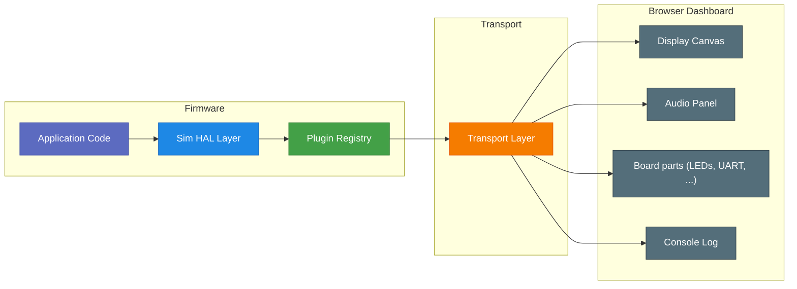

# Simulation Framework

The simulation framework provides virtual peripheral emulation for the QEMU MPS2-AN500 board. It replaces bare-stub HAL implementations with plugin-aware versions that support virtual peripherals, sensor injection, and a browser-based web dashboard for real-time visualisation of display, audio, LEDs, GPIO, and console output.

The an500 board selects `CONFIG_OVE_SIM` (except for the headless Linux personality build).

## Architecture



When `CONFIG_OVE_SIM` is enabled, the sim HAL layer intercepts calls to display, audio, GPIO, and other peripherals. Each peripheral is backed by a **plugin** that processes data and emits events through a **transport** to the browser dashboard.

## Plugin System

Plugins implement virtual peripherals using a vtable interface (`struct ove_sim_plugin_ops`):

| Callback | Required | Description |
|----------|----------|-------------|
| `init` | Yes | Initialise the plugin instance |
| `deinit` | No | Tear down and release resources |
| `handle_cmd` | No | Process a command from the dashboard |
| `tick` | No | Periodic callback (~1 kHz) |
| `get_state` | No | Serialise current state for dashboard polling |

### Plugin Types

| Type | Description |
|------|-------------|
| `OVE_SIM_PLUGIN_DISPLAY` | Display output (framebuffer capture) |
| `OVE_SIM_PLUGIN_AUDIO` | Audio I/O (PCM capture / injection) |
| `OVE_SIM_PLUGIN_GPIO` | GPIO port simulator |
| `OVE_SIM_PLUGIN_LED` | LED state visualiser |
| `OVE_SIM_PLUGIN_I2C_DEV` | Virtual I2C device (sensor, EEPROM) |
| `OVE_SIM_PLUGIN_SPI_DEV` | Virtual SPI device (flash, display) |
| `OVE_SIM_PLUGIN_UART` | Virtual UART / serial terminal |
| `OVE_SIM_PLUGIN_SENSOR` | High-level sensor (accel, gyro, temp) |
| `OVE_SIM_PLUGIN_BUTTON` | Virtual button / touch input |
| `OVE_SIM_PLUGIN_NVS` | Non-volatile storage simulator |

Up to 32 plugins can be registered concurrently (`OVE_SIM_MAX_PLUGINS`).

### Registering a Plugin

```c
#include "ove/sim/ove_sim_plugin.h"

static int my_sensor_init(void *ctx, const void *config, size_t config_len)
{
    /* initialise virtual sensor state */
    return 0;
}

static int my_sensor_cmd(void *ctx, const struct ove_sim_cmd *cmd)
{
    /* handle value injection from dashboard */
    return 0;
}

static const struct ove_sim_plugin_ops my_sensor_ops = {
    .name       = "bme280",
    .type       = OVE_SIM_PLUGIN_SENSOR,
    .init       = my_sensor_init,
    .handle_cmd = my_sensor_cmd,
};

/* At startup: */
int id = ove_sim_plugin_register(&my_sensor_ops, &my_ctx, NULL, 0);
```

## Transport Layers

The transport layer abstracts the communication channel between firmware and the dashboard. It speaks one protocol over files under `/dev/shm`: `ove-sim` (plugin events and commands), `ove-fb` (framebuffer), `ove-audio` (PCM rings) and `ove-input` (pointer state).

| Transport | Source | Used by | Mechanism |
|-----------|--------|---------|-----------|
| Shared memory, guest | `sim/src/ove_sim_transport_shm_guest.c` | QEMU boards | The guest reads and writes the same files through ARM semihosting file I/O; `qemu-run.sh` creates them before the firmware starts |

On the other end, the bridge process (`config/scripts/ove-dashboard-bridge.py`) maps the files and serves the dashboard over HTTP and WebSocket.

The transport implements `struct ove_sim_transport_ops`, so plugin code is transport-agnostic. In the browser the page itself plays the bridge's part (`sim/dashboard/qemu-wasm.js`), reading the same files from Emscripten's in-memory filesystem.

The browser bundle (`web` variant of the QEMU board) uses the guest transport unchanged. The firmware's semihosting files live in the emulator's in-memory filesystem, inside the page, and `sim/dashboard/qemu-wasm.js` plays the part of the bridge, feeding the dashboard the same frames.

### Transport Operations

| Operation | Direction | Description |
|-----------|-----------|-------------|
| `send_event` | Firmware → Dashboard | Push a plugin event |
| `recv_cmd` | Dashboard → Firmware | Receive a command (blocking with timeout) |
| `flush_display` | Firmware → Dashboard | Send framebuffer pixel data (XRGB8888) |
| `push_audio` | Firmware → Dashboard | Send PCM audio samples for playback |
| `pull_audio` | Dashboard → Firmware | Receive PCM audio samples (microphone / file injection) |

## Web Dashboard

The browser-based dashboard (`sim/dashboard/`) is built around a drawing of the simulated board, with every other tool in an inspector beside it.

- **Board**: the LCD (the live LVGL framebuffer; clicks and drags are touch input) and the board's parts, drawn from `boards/<board>/board.yaml`: the MCU with its CPU load, RAM with heap usage, the console UART with TX/RX activity, the debug port, the audio codec, user LEDs, and the status LEDs. Clicking a part opens its tool. The **Reset** switch resets the board (needs the debugger). The display scales to the largest whole-number size that fits (**Auto**), or **Fit**, **1×** or **2×**.
- **Glance strip**: CPU, heap, threads and log warnings at a glance, under the board.
- **Inspector**: Console (shell input, filter, warning/error levels), Threads, Trace, Profiler, Debug and Audio, in one pane or two stacked panes. A tool the build does not enable says which Kconfig option turns it on.
- **Status bar**: run state, simulated time, run control (pause / continue / step / reset), the selected thread, and warning/error counts.

Three **workspaces** set up the inspector for a task: **Run** (console), **Debug** (source, call stack, registers, console) and **Perf** (trace above the profiler). Halting the target switches to Debug and resuming switches back. Pane choices and sizes are kept per build. Selecting a thread (in Threads, or a Trace lane label) highlights it in Trace and filters the Profiler to it.

| Key | Action |
|-----|--------|
| `Ctrl+K` | Command palette |
| `1` `2` `3` | Run / Debug / Perf workspace |
| `F` | Board only |
| `` ` `` | Shell input |
| `/` | Filter the console |
| `Esc` | Clear the thread selection |
| `F6` `F10` `F11` `Shift+F11` | Pause / step over / step into / step out |
| `F5` | Continue (while the Debug panel is shown) |

The board drawing and the tools on offer come from `manifest.json`, built from `board.yaml` and the build's `.config` by `config/scripts/ove_manifest.py`. The local bridge serves it; a `web` bundle ships it next to `index.html`.

The dashboard is served automatically when running a QEMU build:

```bash
make run   # serves the dashboard on http://localhost:8081 (OVE_DASHBOARD_PORT=<n> for another port)
```

## Sim HAL Modules

The `sim/hal/` directory contains HAL implementations that bridge oveRTOS subsystems to the plugin framework:

| File | Subsystem |
|------|-----------|
| `sim_display.c` | LVGL display flush → display plugin |
| `sim_audio.c` | Audio graph device nodes → audio plugin |
| `sim_lvgl.c` | LVGL tick and input driver |
| `sim_board.c` | Board init and plugin registration |
| `sim_debug.c` | Thread and memory snapshots for the dashboard |
| `sim_trace.c` | Thread-state trace stream |
| `sim_profiler.c` | Sampling-profiler batches |

## Trace and Profiler

Two optional plugins stream runtime behaviour into the dashboard:

| Panel | Kconfig | Shows |
|-------|---------|-------|
| Trace | `CONFIG_OVE_TRACE_STREAM`, `CONFIG_OVE_TRACE_MARKERS` | Thread-state swimlanes, sync-primitive markers, dropped/gap intervals |
| Profiler | `CONFIG_OVE_PROFILER` | Flat top-N and flame graph of sampled PCs |

Both are drained by the consolidated sim-debug pump and forwarded by the bridge; the dashboard does not poll.

### Sampling modes

- **On-CPU (FreeRTOS, Zephyr)**: a hardware timer (CMSDK TIMER1 on the an500) or `k_timer` expiry samples the interrupted thread from ISR context. Every sample is `RUNNING`; the period is jittered by ±25% so sampling cannot phase-lock with periodic work. Zephyr's `k_timer` expiry still lands on a tick boundary.
- **Wall-clock (NuttX)**: a watchdog-timed high-priority work item walks every registered thread with `up_backtrace()` (`CONFIG_SCHED_BACKTRACE=y`). Blocked and ready threads are sampled too, so the dashboard can filter to runnable states.
- FreeRTOS and Zephyr share the saved-`{r7, lr}` walker in `backends/common/ove_arm_backtrace.c`; NuttX uses its own unwinder.
- Sampling rate is changed from the dashboard (`SET_RATE`, payload `uint32_t` Hz) and echoed in the caps event. The ceiling is `CONFIG_OVE_PROFILER_HZ` (250 Hz by default); on Zephyr and NuttX it is further clamped to the kernel tick rate, so the effective maximum is the lower of the two.

### Wire formats

Plugin event types and command types use disjoint per-plugin bases (`ove/sim/ove_sim_plugin.h`). The bridge routes events on `event_type` alone; the profiler's runtime plugin id is learned from its events so commands can be addressed rather than broadcast.

**Trace** (`OVE_SIM_TRACE_EVT_STREAM` = 10, `..._DESCRIPTORS` = 11). Envelope:

```
u8  sub_type      0 = descriptors, 1 = stream
u8  version       1
u16 count
u32 dropped       records lost since the previous batch
```

Stream records are 16 bytes each (`struct ove_trace_record`): `u64 ts_us`, `u32 tid`, `u8 kind` (1 = state, 2 = mark), `u8 code` (state value, or `prim << 4 | act` for marks), `u16 arg` (previous state for state records; low 16 bits of the object address for marks). Descriptors repeat `u32 tid`, `u32 generation` (since version 2; new for every thread start, so a new thread on reused storage starts a new lane, and 0 for threads that are not ove threads), `u8 name_len`, `char name[name_len]`.

**Profiler samples** (`OVE_SIM_PROFILER_EVT_SAMPLES` = 20). Envelope:

```
u8  version       1
u8  word_size     sizeof(uintptr_t): 4 on Cortex-M, 8 on 64-bit hosts
u16 count
u32 dropped
```

Each sample is `u64 ts_us`, `u32 tid`, `u8 depth`, `u8 state`, two pad bytes, then `depth` PCs of `word_size` bytes. **Profiler caps** (event 21) carry `u32 max_hz` (the effective maximum, i.e. `CONFIG_OVE_PROFILER_HZ` clamped to the kernel tick rate where the backend applies such a clamp), `u32 current_hz`, `u32 flags` (bit 0 = wall-clock sampling). Symbol tables and the CFG pruner are host-side: the bridge resolves PCs from the firmware ELF with `nm`/`objdump`, so firmware images carry no symbol payload.

## Kconfig Options

| Option | Type | Default | Description |
|--------|------|---------|-------------|
| `CONFIG_OVE_SIM` | bool | selected by the an500 | Enable the simulation plugin framework |
| `CONFIG_OVE_SIM_WEB` | bool | `n` | Also package the QEMU firmware for a web browser (`make web.<rtos>.<app>`; `web-an521.zephyr.<app>` for Zephyr's Linux personality) |
| `CONFIG_OVE_SIM_DASHBOARD` | bool | `y` if SIM | Enable the browser-based dashboard |
| `CONFIG_OVE_THREAD_STATE_STATS` | bool | `y` if SIM | Per-thread state time tracking (prerequisite for trace and profiler) |
| `CONFIG_OVE_TRACE_STREAM` | bool | `y` if SIM | Emit state transitions into the trace ring |
| `CONFIG_OVE_TRACE_MARKERS` | bool | `y` | Emit sync-primitive markers (adds per-operation overhead) |
| `CONFIG_OVE_TRACE_RING_SIZE` | int | 4096 | Trace ring capacity in 16-byte records |
| `CONFIG_OVE_PROFILER` | bool | `y` | Sampling profiler |
| `CONFIG_OVE_PROFILER_HZ` | int | 250 | Mean sample rate (10–1000 Hz) |
| `CONFIG_OVE_PROFILER_MAX_DEPTH` | int | 32 | Maximum captured stack depth |
| `CONFIG_OVE_PROFILER_RING_SIZE` | int | 1024 | Profiler ring capacity in samples |

## Headers

| Header | Contents |
|--------|----------|
| `ove/sim/ove_sim_plugin.h` | Plugin vtable, registry API, event/command types |
| `ove/sim/ove_sim_transport.h` | Transport abstraction and factory functions |
| `ove/sim/ove_sim_display.h` | Display plugin configuration |
| `ove/sim/ove_sim_audio.h` | Audio plugin configuration |
| `ove/sim/ove_sim_gpio_observer.h` | GPIO observation interface |
| `ove/sim/ove_sim_shm.h` | Shared memory layout definitions |
| `ove/sim/ove_sim_spi_dev.h` | SPI device plugin interface |
| `ove/sim/ove_sim_i2c_dev.h` | I2C device plugin interface |
| `ove/sim/ove_sim_trace.h` | Trace event types and record envelope |
| `ove/sim/ove_sim_profiler.h` | Profiler event/command types and sample envelope |
